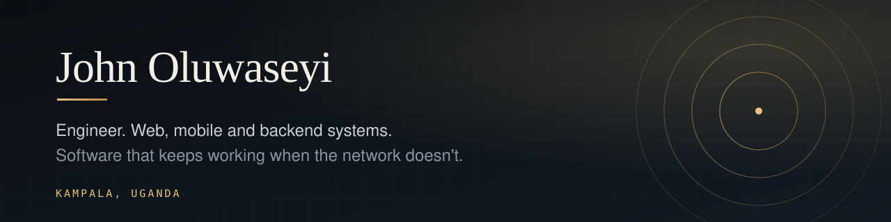

 

I build software for places where the connection is unreliable and the stakes are real: a tyre exporter moving stock between Europe, West Africa and the Gulf, a cinema that has to keep selling tickets when the network drops, a clinic in Wakiso that needs donors to see where their money goes.

I studied Networking and Cybersecurity at ISBAT University, and it shapes how I work. Access is checked on the server, money leaves a paper trail, and the app has to behave when the signal doesn't.

 

## Now

| | |
|---|---|
| **[Okelcor](https://github.com/okelcor-gmbh)** | A tyre supply platform used by buyers and partners across three continents |
| **[Century Cinemax](https://github.com/centurycinemax6)** | Cinema operations, from the box office to e-invoicing and Mobile Money |
| **[WellaPath](https://github.com/Wellapath-org)** | A clinical decision-support app for Nigeria that works offline |

 

## Selected work

<table>
<tr>
<td width="50%" valign="top">

### Cutmio
*Private*

A team of AI agents that edits video for a creator. One reviews the footage, one studies a reference video, one plans the cut, others assemble and finish it. A critic checks the result against the brief before anything is delivered.

`TypeScript`

</td>
<td width="50%" valign="top">

### TradePilot
*Private, in early build*

A workspace for trade transactions where cost, approval and execution live in one record. The domain core is written and tested in Python, with the system design and security model documented. Not deployed yet, and the README says so.

`Python` `Django`

</td>
</tr>
<tr>
<td width="50%" valign="top">

### Humble Vessel
[Live](https://humblevesselfoundationandclinic.org) · [Code](https://github.com/johnseyi/humble-vessel-web)

A website for a community clinic in Bukasa, in English and Luganda. Donors pay by mobile money or international transfer, and staff match each pledge to the payment that actually arrives.

`Next.js` `TypeScript` `WordPress`

</td>
<td width="50%" valign="top">

### Kampala Pressure
*Private*

A browser game about one week of life in Kampala. Three people start with different money and the same Friday deadline: rent is due. The city is hand-drawn in SVG and the characters are fictional.

`TypeScript`

</td>
</tr>
<tr>
<td colspan="2" valign="top">

### Cartolinks Assignment
[Live](https://cartolinks-intern-assignment-web.vercel.app) · [Code](https://github.com/johnseyi/cartolinks-intern-assignment-web)

A frontend internship task: match a supplied design exactly, with dark and light themes, a keyboard-friendly carousel and a layout that holds up on a phone.

`Next.js` `TypeScript` `Tailwind`

</td>
</tr>
</table>

 

## In production

| Product | What it does | |
|---|---|---|
| **Okelcor Website** | Tyre catalogue, order tracking, trade documents and card checkout | [Live](https://www.okelcor.com) |
| **Okelcor API** | Laravel backend for payments, two-factor login, invoices and EU trade paperwork | [Code](https://github.com/okelcor-gmbh/okelcor-api) |
| **Okelcor Partner** | A sales log that works offline for partners in Ghana, Nigeria and the UAE, and syncs without duplicating entries | [Live](https://partners.okelcor.com) |
| **Century Cinemax** | A multi-tenant cinema platform with an offline point of sale | Private |
| **WellaPath Mobile** | Flutter app giving clinicians decision support without a connection | [Code](https://github.com/Wellapath-org/wellapath-mobile) |
| **Munich Nightclub** | Venue site with a live admin panel | [Live](https://munich-nightclub.vercel.app) |

<b>Community and hackathon projects</b>

 

- **[Uganda HIE](https://github.com/Uganda-Hie/uganda-hie)**: a national health information exchange demo, built in three days for the Bank of Uganda BoU@60 hackathon
- **[Takeover Creatives FC](https://github.com/johnseyi/takeover-fc-website)**: a website for a community football club in Kampala
- **[Healthy Steps Foundation](https://github.com/johnseyi/healthy-steps-foundation)**: a nonprofit site with donations and PDF receipts
- **[Let's Talk About Autism](https://github.com/johnseyi/letstalkaboutautism)**: an awareness and resource platform
- **[Goodie Glow Guide](https://github.com/johnseyi/goodie-glow-guide)**: a 30-day skincare guide with a skin-type quiz, in plain JavaScript

 

## Tools

  

 

## Activity

  
  

 

## Contact

[leojohnseyi@gmail.com](mailto:leojohnseyi@gmail.com) · [johnseyi.github.io](https://johnseyi.github.io)
